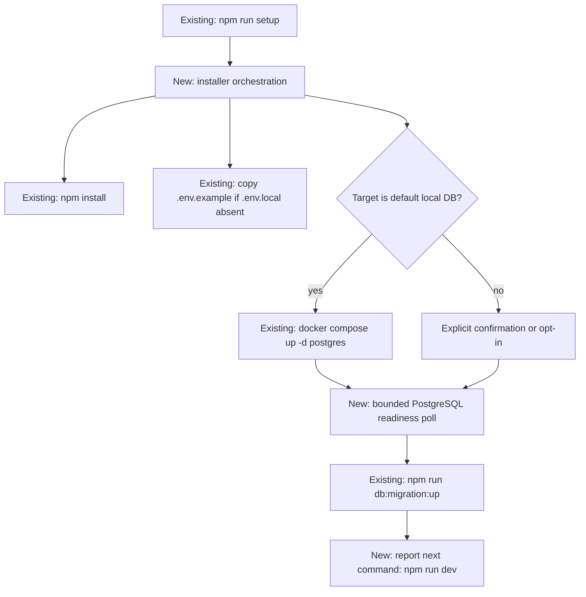

# Idempotent DevMentor installer

## 📝 TLDR

Developers currently have to execute the DevMentor setup commands from the README one by one. This feature adds a root `npm run setup` command that installs workspace dependencies, preserves or creates local environment configuration, starts or reuses the documented PostgreSQL service, waits until the selected database is reachable, and invokes the existing migration command. MikroORM applies only pending migrations. The command exits after provisioning and tells the developer to run `npm run dev`; it never owns a foreground application server.

## 📝 Problem Statement

A fresh checkout has no single, repeatable entry point for local setup. Manual steps are easy to run out of order, and a partially completed setup gives no reliable recovery path. Re-running the current instructions can also encourage overwriting `packages/app/.env.local`, restarting an already-running database, or treating migrations as a one-time setup action even when new migrations have been added.

The affected user is a developer setting up or recovering a local checkout. The repository already defines the intended commands, PostgreSQL Compose service, environment example, and MikroORM migration ledger; the installer should orchestrate those existing contracts.

## 📝 Proposed Solution

Add an additive root `setup` npm script backed by a dependency-free TypeScript CLI entry point. The CLI delegates application behavior to the existing `npm install`, Docker Compose, and `npm run db:migration:up` commands instead of duplicating package or migration logic.

The installer detects actual state on every run:

- It reconciles workspace dependencies with npm on every run, before loading any third-party workspace dependency. A hidden lockfile alone is not treated as proof of complete dependencies.
- It creates `packages/app/.env.local` only when it is absent, copying the example without replacing an existing file.
- It starts or reuses the local Compose PostgreSQL service when the selected target is the documented local database.
- It waits for database readiness by opening a TCP socket to the parsed host and port, with a 60-second timeout and 500-millisecond polling interval, before invoking the migration command. This uses only Node built-ins; successful TCP reachability is followed by the migration command's authenticated connection check.
- It always invokes the existing `npm run db:migration:up` after readiness. MikroORM's migration ledger makes an already-migrated database a no-op and applies only newer migrations; the installer maintains no duplicate ledger or completion marker.
- It reports a resumable failure and stops dependent steps on the first failed prerequisite.
- It exits with a successful handoff message rather than starting `npm run dev`.

When an existing `DATABASE_URL` selects a server outside the documented local Compose target, setup requires explicit confirmation in an interactive terminal or an explicit opt-in environment variable. It never destroys volumes, resets data, prints credentials, or silently migrates an external database.

Common bootstrap tools such as framework starters and ORM CLIs separate provisioning from running the application and make repeat execution safe through state checks. This proposal applies the smallest version of that pattern to this repository: one command, existing infrastructure, and no new runtime dependency or application feature.

## Resolved assumptions (autonomous defaults)

- **Lifecycle:** setup provisions dependencies, configuration, database, and migrations, then exits with `npm run dev` as the next command. This has the smallest operational footprint and avoids duplicate foreground servers on repeat runs.
- **Existing database target:** an interactive confirmation is required for a non-default or external `DATABASE_URL`; non-interactive use must provide an explicit opt-in variable. This protects external data while keeping CI and scripted setup deterministic.
- **Dependency bootstrap:** the root entry point uses only Node.js built-ins and Node 22.17's TypeScript stripping, so `npm run setup` can invoke `npm install` before workspace dependencies exist. No new package is introduced.
- **Readiness strategy:** the installer parses the effective URL, opens a TCP socket to its host and port, polls every 500 milliseconds for at most 60 seconds, and then delegates authentication to MikroORM. It does not add a second database client library.
- **Migration failures:** setup stops immediately and returns nonzero; a later run invokes the same migration command and lets MikroORM determine pending work. The installer does not maintain a second completion marker.

## 📝 Architecture

The new root command is a thin CLI boundary in `scripts/setup.mts`. Its dependency-free orchestration and state model live in `packages/core/src/setup/installer.ts`, which exposes testable functions and accepts filesystem, environment, process, clock, and readiness seams. The module has no React, Next.js, MikroORM, or Effect dependency.

The static entry point imports Node built-ins and the built-in-only core source module; orchestration runs `npm install` before any command needs third-party dependencies. The root script imports that module by relative source path rather than through a workspace package export, so it remains runnable before dependencies exist. The core module itself also imports only Node built-ins.

The runtime flow is:

The CLI owns ordering, state checks, redacted user-facing messages, and exit status. Existing commands own dependency installation, container lifecycle, and migration semantics. The application server is outside this flow.

## 📝 Data Model

No application entity, database table, or migration is added. The installer reads and writes only the developer's local `packages/app/.env.local` file when that file does not exist, and it starts or reuses the existing Compose volume. Migration completion remains owned by the existing `mikro_orm_migrations` ledger.

## 📝 API Contracts

### Root command

- `npm run setup` runs `node --experimental-strip-types scripts/setup.mts`; the built-in-only installer reconciles dependencies before executing commands that need workspace packages.
- Exit code `0`: dependencies, environment, selected database, and all currently pending migrations are ready; the output includes the explicit next command.
- Exit code nonzero: a prerequisite failed or a required confirmation was not supplied. Dependent work is skipped and output includes the failed step and a remediation.
- Existing process environment variables take precedence over env files, matching the repository configuration contract.
- Credentials and full database URLs are never printed.

### Configuration and confirmation

- Missing `packages/app/.env.local`: copy `packages/app/.env.example` and report that it was created.
- Existing `.env.local`: preserve byte-for-byte and report that it was reused.
- Effective configuration: process `DATABASE_URL` wins; otherwise `packages/app/.env.local` is read; when that file is absent, the example is copied first and then read. A malformed URL stops before Docker, readiness polling, or migrations.
- Default local target: host `localhost`, `127.0.0.1`, or `::1`, port `5432`, database `devmentor`, and the documented local Compose service. The username and password may differ, but a non-default host, port, or database is external for confirmation purposes.
- External target: require an interactive yes/no confirmation, or `DEVMENTOR_SETUP_ALLOW_EXTERNAL_DATABASE=1` in a non-interactive process. Any other value is treated as no confirmation. Declining or missing confirmation exits before Docker, readiness polling, or migration.
- Readiness uses `node:net` TCP connection attempts to the parsed host and port, not a database client. Constants are `60_000` milliseconds total and `500` milliseconds between attempts; timeout output includes only a redacted host/port description.

## 📝 UI/UX

There is no application UI change. The terminal experience is the user-facing surface:

- Each step reports whether it ran, was skipped because actual state was already complete, or failed.
- Repeat runs must clearly show reuse of dependencies, environment, database, and migration state.
- Failures name the failed operation, explain what to correct, and identify the next safe rerun.
- Success ends with the exact handoff `npm run dev`.
- Output works in a non-color terminal and does not rely on interactive prompts when explicit opt-in variables are provided.

## 📝 Edge Cases & Failure Scenarios

- Node.js below the documented minimum: stop before mutating project state with an actionable version message.
- `npm install` fails: do not start Docker or migrate; return its nonzero status.
- The example env file or parent directory is missing: stop and identify the repository path.
- `.env.local` is present but invalid: preserve it, report a redacted configuration error, and stop before Docker, readiness polling, or migration.
- Docker is unavailable, Compose fails, or PostgreSQL never becomes ready: stop before migration and explain the required service/action.
- An external database is selected without confirmation: stop before connecting for migration.
- A migration fails: preserve all local state, return nonzero, and permit a later run to retry pending migrations.
- A new migration is added after a successful run: the next run does not trust a marker; it waits for the database and invokes the existing migration ledger.
- Ctrl-C or another interruption: forward termination to the active child process, return nonzero, and perform no cleanup/reset. A migration already running owns its transaction behavior; the installer does not claim that an externally interrupted child can never have committed work.
- A foreground `npm run dev` is already running: setup never starts a second one.

## 📝 Risks & Impact Review

The command gains permission to start the repository's local Compose service and to invoke migrations, so an incorrect target could affect developer data. The exact local-target tuple, explicit external-target confirmation, environment precedence, redacted output, and no-reset policy limit that risk. The implementation changes no HTTP, package export, schema, or runtime configuration contract; it adds one root script and one CLI-only module.

The installer should be rollback-safe by deletion of the additive script and entry point. It must not remove `.env.local`, run `docker compose down`, delete volumes, or edit applied migrations. `docker compose up -d postgres` is allowed for an absent, stopped, or running local service; Compose may recreate the container when its declared configuration has drifted, but the named data volume is retained and no reset command is issued. Testing uses a task-owned disposable PostgreSQL database; the shared development database is never used by tests.

## 📋 Phasing

- **Phase 1 — Installer walking skeleton:** add the dependency-free CLI boundary, step orchestration, environment preservation, and actionable failure propagation.
- **Phase 2 — Database safety:** add local Compose reuse, external-target confirmation, bounded readiness polling, and migration delegation.
- **Phase 3 — Documentation and verification:** update README, cover fresh/repeat/recovery/failure paths, and prove migrations preserve rows and apply once on a disposable database.

## 📋 Implementation Plan

### Phase 1: Bootstrap and orchestration

1. Add the root `setup` npm script and `scripts/setup.mts`, using only Node built-ins so it can run before workspace dependencies are installed.
2. Add the installer orchestration module with injected filesystem/process/environment seams, step results, nonzero failure propagation, Node version validation, and redacted output.
3. Add unit tests for fresh setup, repeat setup, partial setup, interrupted/failed commands, missing prerequisites, and preserved environment contents.

### Phase 2: Database setup

4. Implement environment-target resolution and explicit confirmation for external databases without changing process-variable precedence.
5. Implement Compose start/reuse and bounded PostgreSQL readiness polling without printing credentials or destructive commands.
6. Always delegate migrations to the existing root migration script after readiness; add tests proving a second run is harmless and a later migration remains discoverable through MikroORM's ledger.

### Phase 3: Documentation and integration proof

7. Update README prerequisites, automated setup, repeat/recovery behavior, external-database confirmation, app handoff, manual alternative, and scripts table.
8. Add a disposable-database integration smoke test in a temporary project fixture with an injected `DATABASE_URL`: run the real orchestration twice, insert a row between runs, and prove the row survives while the migration ledger does not reapply completed migrations. The fixture owns its temporary env file and database/container identity and removes only its temporary files and resources in teardown.
9. Run the repository validation gate and applicable integration/E2E checks; record evidence in the run log and PR summary.

## 🧪 Review limits

This autonomous design uses the repository's current README, Compose file, environment example, MikroORM CLI config, package scripts, compatibility contract, and test configuration. It does not assume a production deployment workflow or a new product surface. Review corrections authorized 2026-10-20: migrate with the exact validated `DATABASE_URL` and matching MikroORM host/port/database overrides pinned into the child environment; default interactive detection to the real terminal; redact complete output lines; let npm reconcile dependency state on every run; add minimum-version/Windows compatibility checks with matching required-check updates at publication. This supersedes the issue's original exclusion of CI/ruleset changes, explicitly approved by the maintainer during this fix.

Supported hosts are POSIX and Windows systems with Node.js >=22.17, npm, and Docker Compose v2 for the default local target; child commands use direct argument arrays (npm's JS entry point through `process.execPath`, and `docker.exe` on Windows) and no shell interpolation. The implementation must validate the exact Node 22.17 TypeScript entry-point behavior in CI, forward child interruption, redact delegated output, and keep the integration smoke test isolated from any developer database.
